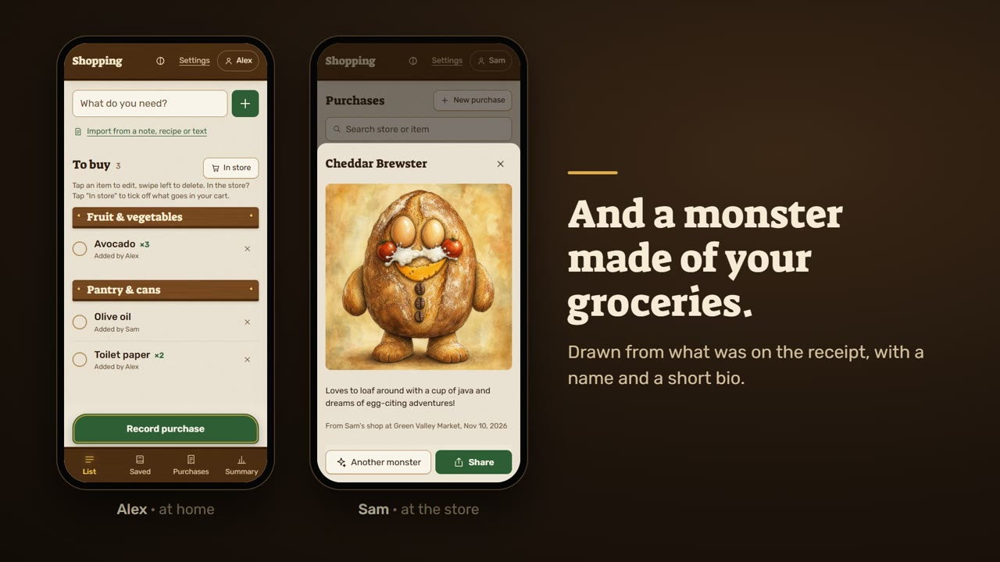
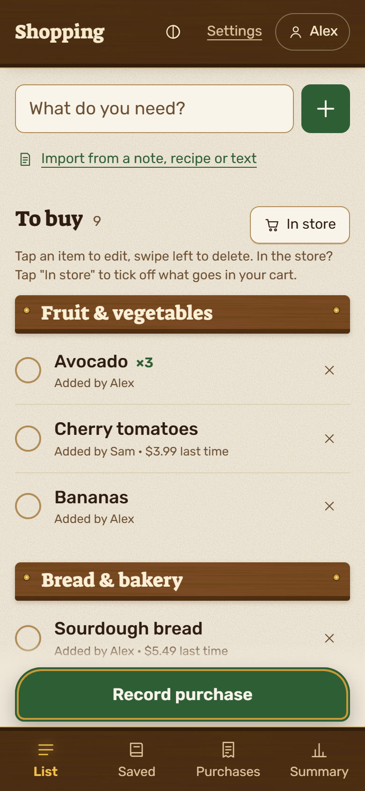
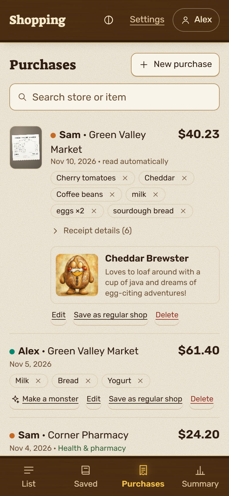
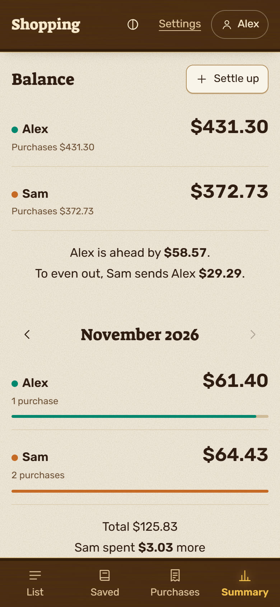
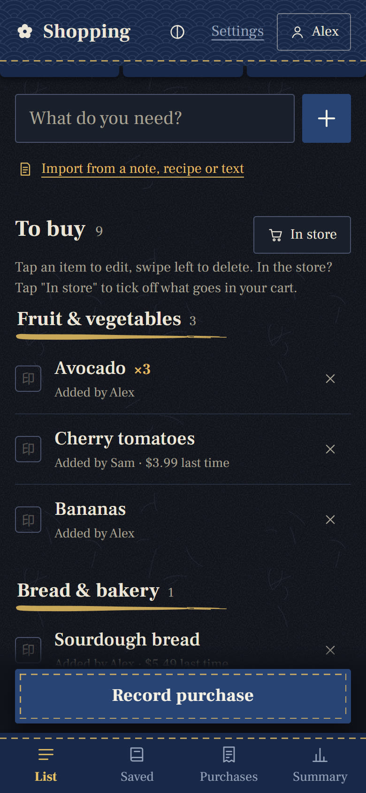

# Shopping List

A shared shopping list for a household, hosted on your own machine. It syncs live between phones, works offline in the store, reads receipts with OpenAI, and keeps track of who paid what.

[](docs/demo.mp4)

**[Watch the 55-second demo](docs/demo.mp4)**

<p>
  
  
  
  
</p>

## What it does

- **One list on every phone.** Add an item and it appears on the others right away, sorted by store section. No signal in the store? Changes wait on the phone and sync later.
- **Store mode.** One tap puts an item in the cart, and the screen stays on while you shop. The app also suggests a song for the trip.
- **Receipts read for you.** Photograph the receipt, or a screenshot of an online order, and the total, store, date and items are filled in. No receipt? Photograph the groceries instead.
- **Import a list** from a handwritten note, a recipe link or pasted text.
- **Saved recipes and regular shops**, added to the list scaled to the number of servings.
- **Who paid what.** A running balance, monthly totals by category and store, a CSV export, and a way to record money sent between you.
- **A monster for each shop.** OpenAI can draw a friendly monster out of what you bought, with a name and a one-line bio.
- **Two themes**, each in light and dark, chosen per phone: Cottage larder and Traditional Japanese.
- **English and Hebrew** (right-to-left) are built in.

There are no accounts. Each phone picks which household member it belongs to, and anyone who can open the app can use it. Run it on your home network or a private one like [Tailscale](#use-it-away-from-home). Don't expose it to the internet.

## Run it

You need [Docker](https://docs.docker.com/get-docker/) with Docker Compose. Clone this repository, then from its folder:

```bash
docker compose up -d --build
```

Open **http://localhost:8080**. A short setup asks for your language and currency, the people in your household, and an OpenAI key (optional). All of it can be changed later under **Settings**.

On phones, open `http://<this-computer's-IP>:8080` and add it to the home screen. Most phones only allow the camera over HTTPS; see [Use it away from home](#use-it-away-from-home).

To update later:

```bash
git pull
docker compose up -d --build
```

## OpenAI (optional)

Without a key, the app works as a shared list and you type purchase totals yourself. With one, it reads receipts, notes and recipe links, and draws monsters.

Create a key at <https://platform.openai.com/api-keys> and paste it into the setup screen or Settings. API usage is billed separately from a ChatGPT subscription. Photos are sent to OpenAI only when you tap **Read**.

| What | Default model | Rough cost |
|---|---|---|
| Basic reading | `gpt-4.1-mini` | $0.002 per photo |
| Careful reading (faded receipts, handwriting) | `gpt-6.1-terra` | $0.005 per photo |
| Monster picture | `gpt-image-2`, medium quality | $0.05 each |

A restricted key needs the **Images** permission for monsters.

## Settings file

Everything here is optional. Copy `.env.example` to `.env`, edit it, and run `docker compose up -d`.

| Variable | Default | What it does |
|---|---|---|
| `TZ` | `UTC` | Your time zone, for example `Europe/London`. |
| `PORT` | `8080` | Port on the host. |
| `BIND_ADDR` | `0.0.0.0` | Set `127.0.0.1` to reach the app only from this machine. |
| `OPENAI_API_KEY` | – | Used instead of the key saved in Settings. |
| `OPENAI_MODEL` | `gpt-4.1-mini` | Basic reading model. |
| `OPENAI_MODEL_STRONG` | `gpt-6.1-terra` | Careful reading model. |
| `OPENAI_IMAGE_MODEL` | `gpt-image-2` | Picture model for monsters. |
| `OPENAI_IMAGE_QUALITY` | `medium` | `low`, `medium` or `high`. |
| `LOG_KEEP_DAYS` | `90` | Days of access log to keep. |

## Your data

Everything stays on your machine and survives rebuilds and updates.

| Where | What |
|---|---|
| Docker volume `shopping-data` | The live SQLite database. |
| `./receipts/` | Receipt photos and monster pictures. |
| `./backups/` | A daily copy of the database. The last 14 are kept. |
| `./logs/` | Access log. API keys are redacted. |

To restore a backup:

```bash
docker compose stop
docker run --rm -v shoppinglist-freaky_shopping-data:/data -v "$PWD/backups":/b alpine \
  sh -c "rm -f /data/shopping.db* && cp /b/shopping-YYYY-MM-DD.db /data/shopping.db"
docker compose start
```

The volume's name starts with the folder name. Check it with `docker volume ls`.

## Use it away from home

[Tailscale](https://tailscale.com) gives you HTTPS and access from anywhere without exposing anything to the internet. It's free for personal use.

1. Install Tailscale on the server and on each phone, and sign in.
2. In the Tailscale admin console, under **DNS**, turn on **MagicDNS** and **HTTPS Certificates**.
3. On the server, run `tailscale serve --bg 8080`.
4. Set `BIND_ADDR=127.0.0.1` in `.env` and run `docker compose up -d`.
5. Open `https://<server>.<your-tailnet>.ts.net` on the phones and add it to the home screen.

On Windows, [`scripts/tailscale-setup.ps1`](scripts/tailscale-setup.ps1) does steps 3 and 4. Any other HTTPS reverse proxy works too, as long as it stays private.

## Development

Plain Node.js 24 with no build step: Express, SQLite through `node:sqlite`, and vanilla JavaScript in the browser.

```bash
cd app
npm install
npm start
```

| File | What's in it |
|---|---|
| `app/server.js` | API, database, OpenAI calls, backups |
| `app/public/app.js` | The whole client |
| `app/public/i18n.js` | UI text for every language |
| `app/public/style.css` | Layout and the two themes |
| `app/public/songs.js` | The store songs |

To add a language, translate the `en` block in `i18n.js` and add it to `LANGS`, then add a matching block to `LANGUAGES` in `server.js`, with a name for the language in each `SECTIONS` and `CATEGORIES` entry.

## License

[MIT](LICENSE)
