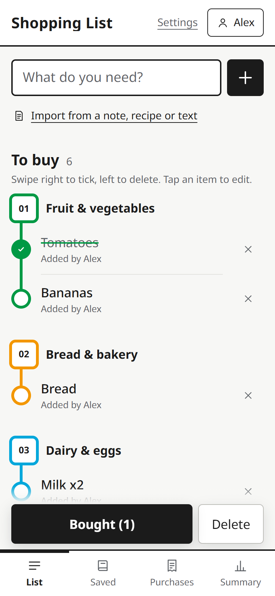
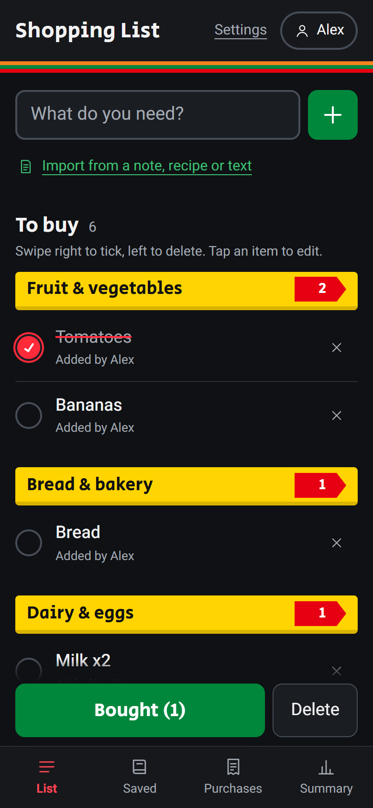
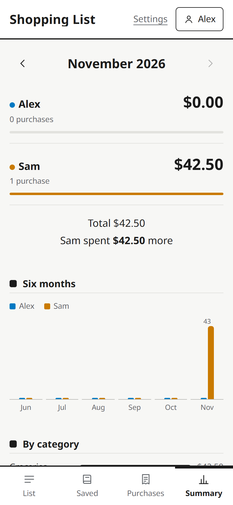
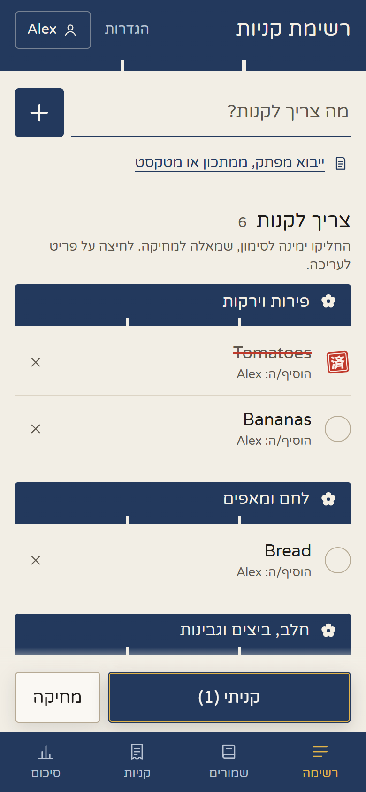
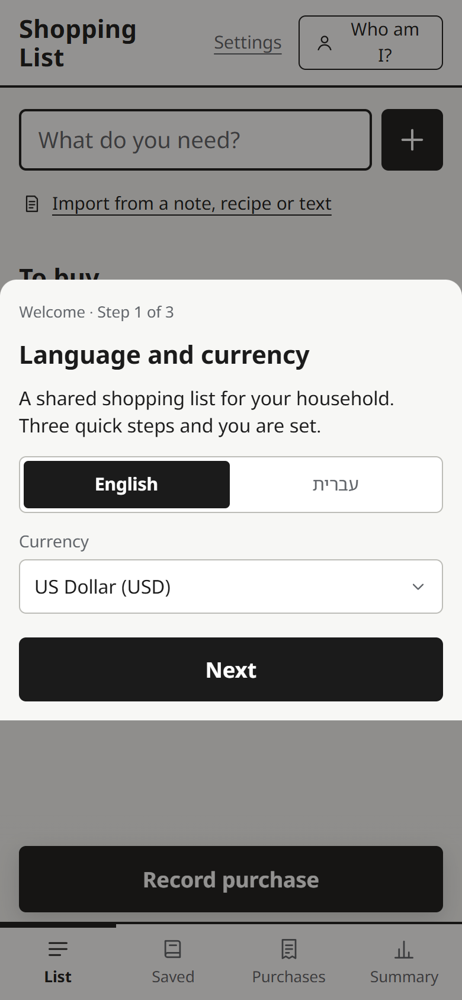
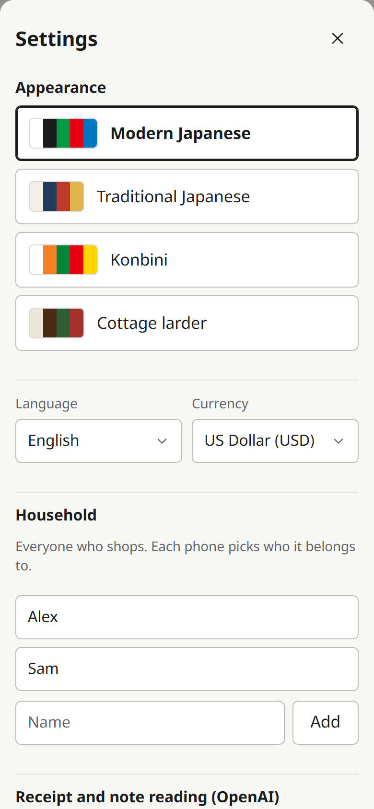

# Shopping List

A self-hosted, shared shopping list for a household. It syncs live between phones, works offline in the supermarket, reads receipts and handwritten notes with OpenAI, and keeps track of who spent what and who owes whom.

This is the expanded edition: everything in the basic one, plus settling up by hand, a song for the store, and a monster drawn from each shop.

English and Hebrew (right-to-left) are built in, and adding a language is a matter of translating one file.

<p>
  
  
  
  
</p>

## Features

- **One shared list**, synced instantly between every phone through server-sent events. Items are sorted by store section (produce, dairy, frozen…) automatically.
- **Works offline.** Changes made with no signal are queued on the phone and synced when the connection is back.
- **Store mode.** In the shop, tap **In store** (or tick any item) and each tap moves an item into the cart. The cart lives on that phone only and empties when you leave, and the screen stays on while you shop.
- **Record purchases.** Tap **Done** and what's in the cart is already ticked. Optionally photograph the receipt: with an OpenAI key, the app reads the total, store, date and which list items were on it.
- **No receipt? Photograph the groceries.** The app names each product it sees and ticks the matching list items. Fix any name with the pencil or add what it missed. The amount is optional, for things you were given.
- **Two reading modes.** A cheap default model for clear photos, and a careful model for faded receipts, handwriting or crowded photos. You choose per photo, and you can cancel a reading.
- **Import a list** from a photo of a handwritten note, a recipe link (it reads the recipe's ingredient data) or pasted text. Each line can be corrected before it's added.
- **Saved recipes and regular shops.** Add a recipe to the list scaled to any number of servings. Items already on the list get a note instead of a duplicate.
- **Spending summary.** Who spent what per month and overall, by category and by store, with a CSV export.
- **Settle up.** The balance at the top of the summary shows who is ahead and how much evens it out. Record money one of you sent the other, or a bill paid outside the app (electricity, rent), with a note. Every settlement stays listed and can be deleted or undone.
- **A song for the store.** Store mode suggests a goofy song from a hand-picked list of about 110 (no AI), preferring songs about something on your list, with a YouTube search link. A Hebrew household gets Hebrew and English songs; any other language gets English ones.
- **Purchase monsters.** Optionally, OpenAI draws a friendly monster built out of what you bought, with a name and a one-line bio in your language, in the art style of your theme. Ask for it when you record a purchase or later from Purchases, then share the picture.
- **Four themes**, chosen per phone: Modern Japanese (metro-line sections), Traditional Japanese, Konbini (convenience-store shelves) and Cottage larder. Each has a light and a dark mode; the button in the header switches between automatic, dark and light.
- **Installable.** Add it to the home screen on iPhone or Android and it opens like an app.
- **Daily database backups** with 14 days kept, plus a per-request access log.

There are no accounts. Each phone picks which household member it belongs to. Anyone who can open the app can use it and change its settings, so run it on your home network or a private network like [Tailscale](https://tailscale.com) (see [Remote access](#remote-access)). Don't expose it directly to the internet.

## Quick start

You need [Docker](https://docs.docker.com/get-docker/) with Docker Compose.

```bash
git clone https://github.com/<you>/ShoppingList-Freaky.git
cd ShoppingList-Freaky
docker compose up -d --build
```

Open **http://localhost:8080**. A short setup screen asks for:

1. **Language and currency**
2. **The people in your household**
3. **An OpenAI API key** (optional; you can add it later in Settings)



To use it from phones on the same Wi-Fi, open `http://<this-computer's-IP>:8080` and add it to the home screen. The camera needs HTTPS on most phones. [Remote access](#remote-access) covers that.

Everything you entered can be changed later under **Settings** in the header: theme, language, currency, people, OpenAI key and models.



## OpenAI (receipt and note reading)

Reading is optional. Without a key, you type purchase totals yourself and the import screen is unavailable.

- Create a key at <https://platform.openai.com/api-keys>. API usage is billed separately from a ChatGPT subscription, and a few dollars of credit lasts a long time.
- Paste it into the setup screen or **Settings → Test → Save key**. It's stored in the app's database. Phones only ever see the last four characters.
- Or set `OPENAI_API_KEY` in `.env` instead (see below). A key set there wins, and can't be changed from a phone.
- Monsters need a key that may create images. A restricted key needs the **Images** permission (`api.model.images.request`); without it the app says so on the purchase.

| Reading | Default model | Typical cost per photo |
|---|---|---|
| Basic | `gpt-4.1-mini` | about $0.002 |
| Careful | `gpt-6.1-terra` | about $0.005 |
| Monster picture | `gpt-image-2`, medium quality | about $0.05 |

Costs are estimates. You can change either model in Settings or with `OPENAI_MODEL` / `OPENAI_MODEL_STRONG`. Any OpenAI model that accepts images works.

Photos are resized on the phone before upload and sent to OpenAI only when you tap **Read**.

## Configuration

Everything is optional. Copy `.env.example` to `.env` to set any of these:

| Variable | Default | What it does |
|---|---|---|
| `TZ` | `UTC` | Your time zone (e.g. `Europe/London`). Decides when "today" starts and when the nightly backup runs. |
| `PORT` | `8080` | Port on the host. |
| `BIND_ADDR` | `0.0.0.0` | `127.0.0.1` makes the app reachable only from this machine (for use behind a reverse proxy or Tailscale Serve). |
| `OPENAI_API_KEY` | – | Overrides the key stored in Settings. |
| `OPENAI_MODEL` | `gpt-4.1-mini` | Basic reading model. |
| `OPENAI_MODEL_STRONG` | `gpt-6.1-terra` | Careful reading model. |
| `OPENAI_IMAGE_MODEL` | `gpt-image-2` | Picture model for monsters. `gpt-image-1-mini` is about five times cheaper and simpler. |
| `OPENAI_IMAGE_QUALITY` | `medium` | `low`, `medium` or `high`. |
| `LOG_KEEP_DAYS` | `90` | Days of access log to keep. |

After editing `.env`, apply it:

```bash
docker compose up -d
```

## Your data

| Where | What |
|---|---|
| Docker volume `shopping-data` | The live SQLite database. |
| `./receipts/` | Every receipt photo and monster picture, as plain JPG files. |
| `./backups/` | A copy of the database, written daily; the last 14 are kept. |
| `./logs/` | Access log, one JSON line per request. API keys are redacted. |

All of it survives container rebuilds and updates.

**Restore a backup:**

```bash
docker compose stop
docker run --rm -v shoppinglist-freaky_shopping-data:/data -v "$PWD/backups":/b alpine \
  sh -c "rm -f /data/shopping.db* && cp /b/shopping-YYYY-MM-DD.db /data/shopping.db"
docker compose start
```

The volume's name starts with the folder name. Check it with `docker volume ls`.

**Update** to a newer version:

```bash
git pull
docker compose up -d --build
```

## Remote access

To use the list outside your home Wi-Fi, with HTTPS (which phone cameras need), the simplest option is [Tailscale](https://tailscale.com). It's free for personal use and nothing is exposed to the internet:

1. Install Tailscale on the server and on each phone, and sign in.
2. In the Tailscale admin console, under **DNS**, turn on **MagicDNS** and **HTTPS Certificates**.
3. On the server, run:
   ```bash
   tailscale serve --bg 8080
   ```
4. Set `BIND_ADDR=127.0.0.1` in `.env`, then run `docker compose up -d`, so the plain HTTP port is closed to the network.
5. Open `https://<server>.<your-tailnet>.ts.net` on the phones and add it to the home screen.

To give someone else access without adding them to your Tailscale account, share the machine from the admin console (**Machines → … → Share**).

On Windows, [`scripts/tailscale-setup.ps1`](scripts/tailscale-setup.ps1) does steps 3 and 4 for you; run it with `-Undo` to revert.

Any other HTTPS reverse proxy (Caddy, nginx, Traefik) in front of port 8080 works too. Keep it private: the app has no login.

## Development

The app is plain Node.js with no build step: Express, SQLite through Node's built-in `node:sqlite`, and vanilla JavaScript in the browser.

```bash
cd app
npm install
npm start   # http://localhost:8080, data in app/data/
```

It requires Node.js 24 or newer.

```
app/
  server.js            API, SQLite schema, OpenAI calls, backups, access log
  public/
    index.html         page markup (static text carries data-i18n keys)
    app.js             the whole client: list, purchases, import, saved, summary, settings, setup
    i18n.js            UI text for every language
    songs.js           the store songs, hand-picked, with the list words each one is about
    style.css          layout and the four themes
    sw.js              service worker (offline app shell)
```

### Adding a language

1. In `app/public/i18n.js`, copy the `en` block, translate it, and add the language to `LANGS` (its label, `ltr`/`rtl` and locale).
2. In `app/server.js`, add a block to `LANGUAGES` (examples for the AI prompt, default list name, CSV headers), and a name for the new language in each `SECTIONS` and `CATEGORIES` entry.

It then appears in the setup screen and in Settings.

## License

[MIT](LICENSE)
